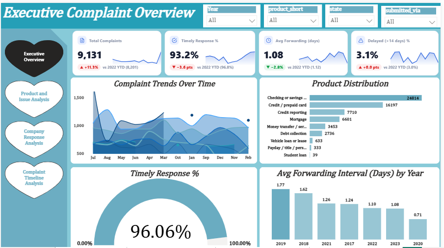
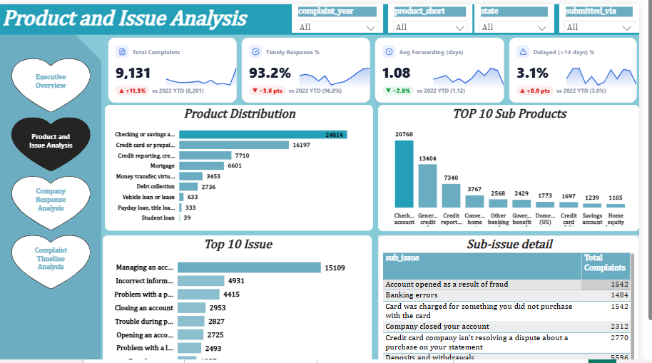
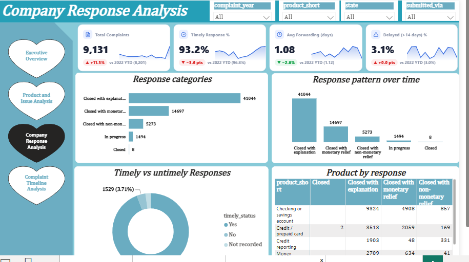
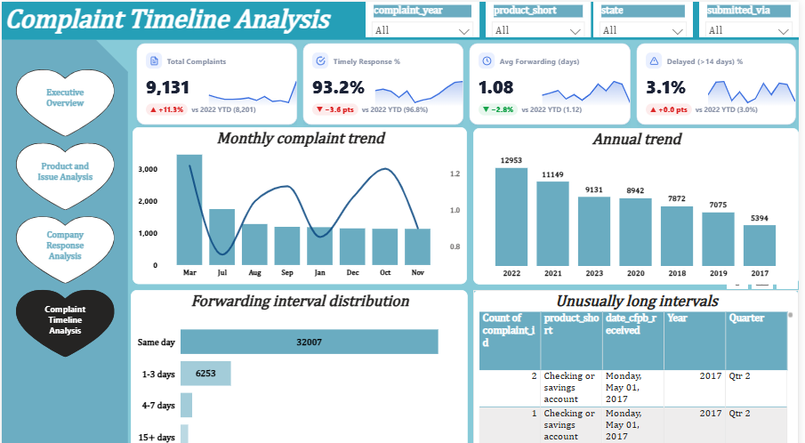

# Complaint_Analysis
# Consumer Complaint Monitoring and Response Dashboard

**AnalystLab Africa Experience Lab Internship | Week 4 | Data Analytics Track**
**Project:** Consumer Complaint Trends and Response Intelligence Platform
**Dataset:** CFPB consumer complaints relating to Bank of America, 1 May 2017 to 28 Aug 2023 (62,516 records)


## 1. Project overview

Financial institutions receive complaints about products such as bank accounts, credit cards, mortgages and credit reporting. The Consumer Financial Protection Bureau (CFPB) collects these complaints and forwards eligible ones to the company for a response.

This project cleans the supplied complaint records, defines and validates a set of KPIs, and presents them in a four-page interactive Power BI dashboard so stakeholders can monitor complaint volumes, frequently reported products and issues, recorded company responses and CFPB complaint-forwarding intervals.

> **Important interpretation rule.** A complaint is an issue reported by a consumer. It does not establish misconduct or prove that the company violated any regulation. A recorded company response is a category, not proof of satisfactory resolution. All findings in this project are descriptive and based only on the supplied data.

### Business questions and where they are answered

| # | Business question | Where answered |
|---|---|---|
| 1 | How have complaint volumes changed 2017-2023? | Dashboard pages 1 and 4, `KPI_DEFINITIONS.md` (annual and YoY) |
| 2 | Which financial products have the highest volumes? | Page 1 and page 2 |
| 3 | What are the most frequently reported issues? | Page 2 |
| 4 | How do issues differ across product categories? | Page 2 (product-versus-issue matrix) |
| 5 | How long between CFPB receipt and forwarding to the company? | Page 4 |
| 6 | Which company response categories are most frequent? | Page 3 |
| 7 | What % of complaints have a recorded timely response? | Pages 1 and 3 |
| 8 | Have patterns and response categories changed over time? | Pages 3 and 4, insights document |
| 9 | Can history support complaint-volume forecasting? | Outside the Data Analytics deliverables. The monthly series on page 4 is the input for the forecasting track. |
| 10 | How can stakeholders access validated insights? | The interactive dashboard (this track). Natural-language access belongs to the Generative AI track. |

Questions the data cannot answer are listed in `BUSINESS_INSIGHTS_AND_RECOMMENDATIONS.md`.

---

## 2. Dataset

| Item | Detail |
|---|---|
| Source | Consumer Financial Protection Bureau (CFPB), supplied by AnalystLab Africa |
| File | `Consumer_Complaints.xlsx` (sheet `Data`) |
| Records / columns | 62,516 rows, 12 columns |
| Period | 1 May 2017 to 28 Aug 2023 (2017 and 2023 are partial years) |
| Primary key | `Complaint ID` (unique) |

Columns: Complaint ID, Submitted via, Date submitted, Date received, State, Product, Sub-product, Issue, Sub-issue, Company public response, Company response to consumer, Timely response?

**Date meaning (easy to confuse):**
- `Date submitted` = date the CFPB **received** the complaint.
- `Date received` = date the CFPB **sent** the complaint to the company.
- **Forwarding interval** = `Date received` - `Date submitted`. This is a CFPB processing interval. It is **not** the company's response or resolution time.

---

## 3. Tools and technologies

| Tool | Purpose |
|---|---|
| Microsoft Excel | Receiving and inspecting the source workbook |
| Python (pandas) | One-off conversion of the Excel sheet to CSV with ISO dates (`Consumer_Complaints_raw.csv`) and independent cross-checks of the SQL and dashboard figures |
| MySQL 8.0 and MySQL Workbench | Raw data staging, data cleaning, validation and KPI queries |
| SQL | `complaints_raw` (untouched copy) and `complaints_clean` (analysis table) in database `complaints_db` |
| Power BI Desktop | Data model, DAX measures and the four-page dashboard |
| DAX | KPI measures and dynamic HTML KPI cards |
| HTML Content (Power BI custom visual) | Renders the KPI cards with sparklines and year-over-year indicators |
| GitHub | Version control and submission |

---

## 4. Methodology

1. **Preserve the original.** The source workbook is unchanged. It was exported to `Consumer_Complaints_raw.csv` and loaded as text into `complaints_raw`, so the raw table is an exact copy.
2. **Inspect.** Row count, column types, key uniqueness, blanks per column, category spellings, date validity and interval logic (see `DATA_QUALITY_REPORT.md`).
3. **Clean.** `complaints_clean` is built from `complaints_raw` by `01_cleaning_and_kpis_mysql.sql`: trim text, convert dates, handle blanks by meaning, shorten product labels, and add derived fields (year, quarter, month, forwarding interval, interval bucket, long-interval flag, partial-year flag).
4. **Validate.** Row counts, key uniqueness, timely-status counts, interval ranges and every KPI were checked against an independent calculation in Python (reference values in section 8).
5. **Define KPIs.** Twelve KPIs are defined with formulas in `KPI_DEFINITIONS.md`.
6. **Model and measure.** `complaints_clean` is loaded into Power BI. Measures live in `02_dax_measures.dax`.
7. **Build the dashboard.** Four pages with shared slicers, titles, KPI cards and a navigation panel.
8. **Interpret.** Findings and recommendations are in `BUSINESS_INSIGHTS_AND_RECOMMENDATIONS.md`.

### Key cleaning decisions

| Field / issue | Decision | Reason |
|---|---|---|
| Duplicate Complaint IDs | None found; `ROW_NUMBER()` safeguard kept in the script | Primary key is unique |
| Blank `Sub-issue` (10,858) | Labelled "Not specified" | The consumer or company did not give a more detailed issue; it is not an error |
| Blank `Sub-product` (7) | Labelled "Not specified" | Too few rows to infer a value |
| Blank `Company public response` (2,175) | Labelled "Blank / not recorded" | Not only in-progress rows (1,494 are in progress; 681 are closed), so it was not tied to one status |
| Blank `Timely response?` (1,494) | Labelled "Not recorded". **Never treated as "No".** All 1,494 are "In progress" | Per the brief |
| Timely % | Denominator = records with a valid Yes or No only; excluded rows reported separately | Per the brief |
| `Referral` vs `Web Referral`, 8 `Closed` rows | Kept as supplied and documented | Meaning cannot be confirmed from the data dictionary |
| Product names | Long names shortened in `product_short` (original kept in `product`) | Readable visuals |

---

## 5. Repository structure

```
consumer-complaint-dashboard/
|-- README.md
|-- DATA_QUALITY_REPORT.md
|-- KPI_DEFINITIONS.md
|-- BUSINESS_INSIGHTS_AND_RECOMMENDATIONS.md
|-- data/
|   |-- Consumer_Complaints.xlsx            (original, unchanged)
|   |-- Consumer_Complaints_raw.csv         (CSV copy with ISO dates)
|-- sql/
|   |-- 01_cleaning_and_kpis_mysql.sql      (staging, inspection, cleaning, validation, KPI queries)
|-- dax/
|   |-- 02_dax_measures.dax                 (dashboard measures and HTML KPI cards)
|-- dashboard/
|   |-- Consumer_Complaint_Dashboard.pbix
|   |-- screenshots/                        (one image per page)
|   |-- complaint_kpi_cards.html            (static preview of the KPI cards)
|-- presentation/
    |-- (recorded 5-10 minute walkthrough link)
```

---

## 6. Analysis Procedure

**Requirements:** MySQL 8.0+ with MySQL Workbench, Power BI Desktop, and the "HTML Content" custom visual (Get more visuals).

1. **Create the database and raw table.** Run the first section of `sql/01_cleaning_and_kpis_mysql.sql` (creates `complaints_db` and `complaints_raw`).
2. **Load the CSV.** Enable local infile and run:
   ```sql
   SET GLOBAL local_infile = 1;
   TRUNCATE TABLE complaints_raw;
   LOAD DATA LOCAL INFILE 'C:/path/Consumer_Complaints_raw.csv'
   INTO TABLE complaints_raw
   CHARACTER SET utf8mb4
   FIELDS TERMINATED BY ',' OPTIONALLY ENCLOSED BY '"'
   LINES TERMINATED BY '\n'
   IGNORE 1 LINES;
   SELECT COUNT(*) FROM complaints_raw;   -- expect 62516
   ```
3. **Run the rest of the SQL script in order:** inspection, cleaning (`complaints_clean`), validation, KPI queries. Compare results with the expected values at the top of the script.
4. **Connect Power BI** to MySQL (`complaints_db`) and load `complaints_clean`. Set `date_cfpb_received` and `date_sent_to_company` to **Date**, and `forwarding_interval_days`, `complaint_year` and `long_interval_flag` to **Whole number**.
5. **Add the measures** from `dax/02_dax_measures.dax` (and the `Interval Bucket Sort` calculated column, then set `interval_bucket` to sort by it).
6. **Build the pages** as described in section 7. Add `KPI Cards HTML` to the HTML Content visual.

---

## 7. Dashboard

Shared slicers on every page: `complaint_year`, `product_short`, `state`, `submitted_via`. Each page has a KPI card row and a navigation panel.

| Page | Contents |
|---|---|
| **1. Executive Complaint Overview** | KPI cards (total complaints, timely response %, average forwarding interval, delayed >14 days %) with sparklines and green/red year-over-year indicators; complaint trend over time; product distribution; timely response gauge; average forwarding interval by year |

| **2. Product and Issue Analysis** | Product distribution; top 10 sub-products; top 10 issues; sub-issue detail; product-versus-issue matrix |

| **3. Company Response Analysis** | Response categories; response pattern by year; timely vs untimely distribution; in-progress complaints; public response categories; product-by-response matrix |

| **4. Complaint Timeline Analysis** | Monthly trend with average interval; annual trend; forwarding interval distribution; interval by product; table of unusually long intervals (>14 days) |


**About the KPI cards.** The cards always compare the latest year-to-date (1 Jan to 28 Aug 2023) with the same period of 2022. This avoids comparing a partial year with a full year. They ignore the year slicer on purpose. Green means a favourable change and red an unfavourable one (fewer complaints, a higher timely %, a shorter interval and a smaller delayed share are favourable).


## 8. Validation reference values

These were calculated independently and should match the SQL output and the dashboard (all years, no filters):

| Check | Expected |
|---|---|
| Rows / unique IDs | 62,516 / 62,516 |
| Timely Yes / No / not recorded | 58,619 / 2,403 / 1,494 |
| Timely response % (Yes / (Yes + No)) | 96.06% |
| In-progress complaints | 1,494 |
| Forwarding interval: average / median / 95th percentile / max | 1.22 / 0 / 5 / 275 days |
| Interval buckets: same day / 1-3 / 4-7 / 8-14 / 15+ days | 49,634 / 8,431 / 2,008 / 937 / 1,506 |
| Complaints by year 2017 to 2023 | 5,394 / 7,872 / 7,075 / 8,942 / 11,149 / 12,953 / 9,131 |
| 2023 YTD vs 2022 same period | 9,131 vs 8,201 (+11.3%) |

---

## 9. Key findings (summary)

Full evidence is in `BUSINESS_INSIGHTS_AND_RECOMMENDATIONS.pdf`.

1. Annual complaint volume rose from 7,075 (2019) to 12,953 (2022); 2023 year-to-date is 11.3% above the same period of 2022.
2. Checking or savings accounts and credit/prepaid cards make up 65.6% of complaints; "Managing an account" alone is 24.2%.
3. The mix has shifted: checking/savings rose to 44.7% of 2023 year-to-date complaints while mortgage fell from 23.1% (2017) to 3.9%.
4. The recorded timely-response rate is 96.06% overall but fell to 89.0% in 2021.
5. 79.4% of complaints are forwarded the same day, but 1,506 (2.4%) take more than 14 days, up from 0.5% in 2020 to about 3% in 2022-2023.
6. July 2023 was the highest month on record (1,749 complaints, 72% above June).

---

## 10. Assumptions

- The supplied file is a flat extract, not a relational database.
- "Timely response?" is used exactly as recorded; it is not independently verified.
- Complaint counts are not normalised by customer base, state population or transaction volume.
- 2017 (from 1 May) and 2023 (to 28 Aug) are partial years, so annual comparisons involving them use year-to-date logic or carry a note.

## 11. Limitations

- No complaint narratives, company-response dates, resolution outcomes or consumer harm data are included, so resolution quality and company response time cannot be measured.
- Recorded responses ("closed with explanation", "monetary relief") describe the category recorded, not whether the consumer was satisfied.
- Complaint volume reflects consumer reporting behaviour and CFPB intake, which can change independently of company performance.
- State counts reflect population and customer presence; no per-capita adjustment is available.
- Associations in the dashboard are descriptive and must not be read as causes.


## 15. Source and attribution

Dataset: Consumer Complaints on Financial Products and Services, Bank of America (2017-2023). Data provider: Consumer Financial Protection Bureau (CFPB). Supplied by AnalystLab Africa for training purposes. This project is not an official CFPB or Bank of America product.

\#AnalystLabAfrica
